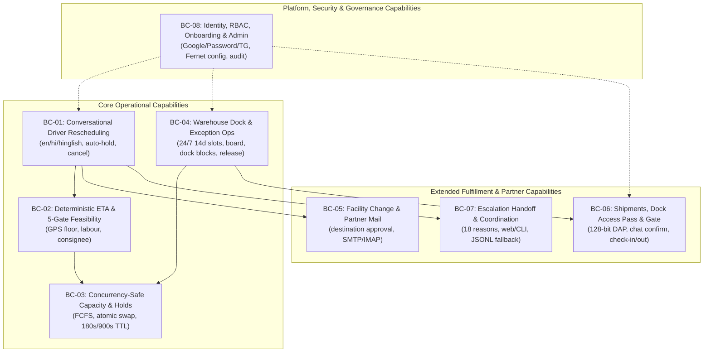

# DOC-02: Product Requirements Document (PRD) & Business Capability Map

| Field | Value |
|---|---|
| **Document ID** | `DOC-02` |
| **Version** | `1.0.0` |
| **Category** | 1 — Business & Product |
| **Repository Commit** | `445c7f965e22e7915238cca5631e68b4462d7b7b` |
| **Validation Status** | Verified against implemented code and product specs |

---

## 1. Purpose and Scope
This document defines the product vision, user personas, Business Capability Map (`BC-01`–`BC-08`), product workflows, and release readiness gaps for `SetuHaul_Rescheduling_Service`.

## 2. Executive Summary
SetuHaul serves five distinct operational personas across two interaction surfaces: a **Telegram conversational bot** for truck drivers (plus an HMAC machine channel) and a **role-scoped server-rendered web application** (`/admin`, `/warehouse`, `/gate`, `/wiki`) for internal staff (`[Verified]`, `README.md:56-65,113-120`). The product's signature design choice is the **auto-hold one-slot flow** (`D93`): instead of presenting a numbered menu, the service holds the first feasible slot and lets the driver confirm (`Yes`) or cycle to the next slot (`No`) (`[Verified]`, `src/setuhaul/tools.py:644,936-1002`).

---

## 3. Business Capability Map `[Verified]`

| ID | Capability | Primary Personas | Key Modules | Maturity Status |
|---|---|---|---|---|
| `BC-01` | Conversational Driver Rescheduling | `ACT-01` | `conversation.py`, `tools.py`, `language.py`, `model_gateway.py` | Prototype (`[Unverified]` on live LLM post-11/27) |
| `BC-02` | Deterministic ETA & Feasibility Evaluation | `ACT-01`, `ACT-02` | `eta.py`, `gps.py`, `travel.py`, `feasibility.py`, `capacity.py` | `[Verified]` (unit/property tests) |
| `BC-03` | Concurrency-Safe Capacity & Hold Management | `ACT-01`, `ACT-02` | `booking.py`, `allocation.py`, `option_history.py`, `expire_holds.py` | `[Verified]` (100 contention runs) |
| `BC-04` | Warehouse Dock & Exception Operations | `ACT-02`, `ACT-04` | `board.py`, `round_clock.py`, `dock_blocks.py`, `release.py`, `assign.py` | `[Verified]` (unit/UI tests) |
| `BC-05` | Facility Change & Partner Warehouse Coordination | `ACT-01`, `ACT-02`, `ACT-07` | `facility_change.py`, `partner_booking.py`, `mail_transport.py` | `[Verified]` (simulated); `[Unverified]` live SMTP/IMAP |
| `BC-06` | Shipment Assignment, Dock Access Pass & Gate Control | `ACT-01`, `ACT-02`, `ACT-03` | `dock_pass.py`, `passes.py`, `pass_check.py`, `gate.py`, `shipments.py` | `[Verified]` (unit/E2E tests) |
| `BC-07` | Escalation Handoff & Coordinator Workflow | `ACT-02`, `ACT-04`, `ACT-05` | `escalation.py`, `coordinator.py`, `api.py` | `[Verified]` |
| `BC-08` | Identity, RBAC, Driver Onboarding & Platform Admin | `ACT-02`, `ACT-03`, `ACT-04` | `auth/*`, `app_settings.py`, `model_report.py`, `retention.py` | `[Verified]` (fake IdP); `[Unverified]` real Google/TG |

---

## 4. Personas & Value Propositions `[Verified]`

| ID | Persona | Goals | Surface | Constraints |
|---|---|---|---|---|
| `ACT-01` | **Truck Driver** | Report delay/breakdown in preferred language, confirm new slot quickly, receive Dock Access Pass. | Telegram Bot (self-contact phone binding) | No web UI; must be `ACTIVE`/`OFF_DUTY`, `APPROVED`, valid licence (`auth/onboarding.py:207-216`). |
| `ACT-02` | **Warehouse Authority** | View daily dock board, manage 24/7 crew counts, block docks safely, resolve escalated cases, approve facility changes, create shipments, onboard drivers. | `/warehouse`, `/wiki` | Strictly scoped to assigned facilities (`auth/authz.py:42-107`). |
| `ACT-03` | **Gate Security Guard** | Validate Dock Access Pass, vehicle registration, and licence; check trucks in and out (supports QR/barcode camera or wedge scanner). | `/gate`, `/wiki` | Facility-scoped; rate-limited to 10 failures / 15 min (`gate.py:31-303`). |
| `ACT-04` | **System Administrator** | Invite/disable/delete users, approve/restore drivers, inspect audit log & model usage/costs, configure LLM/LangSmith/Telegram/Email at runtime. | `/admin`, `/warehouse`, `/gate`, `/wiki` | Global scope; cannot self-disable or disable last active admin (`auth/admin_api.py:120-136`). |
| `ACT-05` | **Operations Coordinator** | Claim, resolve, and reopen escalation cases via machine API or CLI. | `/v1/coordinator/cases/*`, `python -m setuhaul.coordinator` | Bearer token unscoped across facilities; cannot pass `slot_id` on resolve (`api.py:966-1071`). |

---

## 5. Product Feature Scope & Release Readiness
- **Implemented & Tested**: 15 core functional requirement groups (`FR-01`–`FR-15`), backed by 2,127 automated tests across 142 test files (`[Verified]`).
- **Not Implemented / Deferred**:
  - Downstream outbound notification transport for `WAREHOUSE_PLANNER`, `CONSIGNEE`, and `OPERATIONS` (`[Verified]`, `docs/deployment-hostinger.md:186`).
  - Phase 13 facility-wide schedule optimization (`[Verified]`, `docs/problem-definition.md:78`).
  - Native-speaker review of Hindi and Hinglish driver templates (`[Missing]`, `docs/model-contract.md:66-69`).
  - Self-service driver data export / privacy consent banner (`[Missing]`, `docs/faq.md:292-301`).

---

## 6. Source Evidence & Traceability
- Knowledge Model: `BC-01`–`BC-08`, `ACT-01`–`ACT-07`, `FR-01`–`FR-15`.
- Existing docs: `README.md`, `docs/client-readout.md`, `docs/dock-access-pass.md`, `docs/superpowers/specs/`.

## 7. Assumptions, Limitations & Open Questions
- Product acceptance metrics from the original brief (median $\le 2$ clarification turns, $\ge 80\%$ auto-resolution) remain `[Unverified]` on live LLMs (`docs/verification/evaluation-plan.md:76-77`).
- Open questions: Which LLM provider/model is approved for production (`Q9`)? Should downstream planner/consignee notifications be delivered via email, webhook, or ERP integration (`Q8`)?
