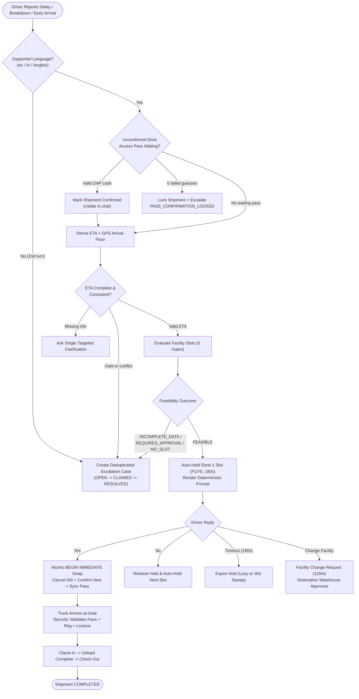

# DOC-03: Business Process Specification & Business Rules Catalogue

| Field | Value |
|---|---|
| **Document ID** | `DOC-03` |
| **Version** | `1.0.0` |
| **Category** | 1 — Business & Product |
| **Repository Commit** | `445c7f965e22e7915238cca5631e68b4462d7b7b` |
| **Validation Status** | Verified against `src/setuhaul/` and `migrations/` |

---

## 1. Purpose and Scope
This document specifies the end-to-end business processes and the authoritative Business Rules Catalogue (`BR-01`–`BR-16`) enforced deterministically by `SetuHaul_Rescheduling_Service`.

## 2. Executive Summary
Every operational decision in SetuHaul—from ETA derivation and five-gate slot feasibility to FCFS hold contention, atomic appointment confirmation, dock blocking, facility changes, partner email approvals, and gate security checks—is encoded as deterministic Python business rules backed by SQLite constraints (`[Verified]`). The LLM never evaluates feasibility, never computes timestamps, and never authors committed booking confirmations (`[Verified]`, `src/setuhaul/conversation.py:408-523`).

---

## 3. End-to-End Business Process Specification `[Verified]`

*(Editable Mermaid source: [`docs/enterprise/diagrams/11-business-process-rescheduling.mmd`](../diagrams/11-business-process-rescheduling.mmd))*

### Key Sub-Processes `[Verified]`
1. **BP-01: Driver Delay & Auto-Hold Rescheduling**: Driver sends message -> idempotency & rate-limit -> pass pre-check -> language gate -> LLM calls `search_slot_options` -> deterministic ETA + GPS floor + 5-gate feasibility -> auto-hold rank 1 (`180s` TTL) -> driver replies `Yes` (`confirm_reschedule` atomic swap) or `No` (`decline_held_slot` cycles to next slot) (`src/setuhaul/conversation.py`, `tools.py`, `booking.py`).
2. **BP-02: Proactive GPS Reassessment**: New GPS ping (`POST /v1/gps/pings` or `/v1/driver/location`) -> `position.handle_driver_position()` -> releases unreachable live hold (`POSITION_CHANGED`) or proactively auto-holds an earlier slot $\ge 30\text{ min}$ faster for `900s` (`src/setuhaul/position.py:67-196`).
3. **BP-03: Two-Turn Cancellation**: Turn 1 previews cancellation (`PendingCancel`, 10-min window) -> Turn 2 requires explicit confirmation (`agrees_to_cancel`); refuses if on-site/`IN_PROGRESS`; escalates if $< 120\text{ min}$ ahead or penalty-bearing/unknown consignee commitment (`src/setuhaul/cancellation.py:141-250`, `tools.py:982-990`).
4. **BP-04: Dock Blocking & Displacement**: Warehouse previews block (`POST /v1/warehouse/dock-blocks/preview`) -> system prioritizes caught bookings (`CRITICAL > HIGH > NORMAL > LOW`) and plans closest-in-time move on another dock (or `FREE`/`SKIP`) -> warehouse confirms with optimistic `expected` plan (`409 PLAN_CHANGED` on drift) (`src/setuhaul/dock_blocks.py:221-327`).
5. **BP-05: Facility Change & Partner Email Booking**: Driver requests facility move (`120m` TTL) -> destination warehouse approves -> moves `destination_facility_id` and revokes/reissues pass -> own facility auto-holds `15m`; partner facility emails `[PR-XXXXXXXX]` -> strict `APPROVE`/`DECLINE` reply verified via SPF/DKIM/DMARC -> atomic booking or revert (`src/setuhaul/facility_change.py`, `partner_booking.py`).
6. **BP-06: Dock Access Pass & Gate Fulfillment**: Warehouse creates shipment -> 128-bit `DAP-...` delivered over Telegram (SHA-256 stored) -> driver confirms once in chat (5-failure lock) -> security validates pass + vehicle reg + licence at `/gate` -> check-in (`AT_GATE`) -> warehouse marks unloading complete (`OPERATIONS_COMPLETE`) -> security checks out (`COMPLETED`) (`src/setuhaul/passes.py`, `pass_check.py`, `gate.py`).

---

## 4. Business Rules Catalogue `[Verified]`

| Rule ID | Rule Name | Formal Specification | Parameters / Thresholds | Source Evidence |
|---|---|---|---|---|
| `BR-01` | Operational Timezone (IST) | All operational timestamps must include an explicit offset and are normalized to `Asia/Kolkata`. Naive timestamps are rejected. | `SETUHAUL_TIMEZONE=Asia/Kolkata` | `src/setuhaul/config.py:28`, `src/setuhaul/db.py:39-65`, `src/setuhaul/schemas.py:23-29` |
| `BR-02` | ETA Precedence & Late-By Baseline (D6) | Gate-in + delay report yields `CONTRADICTORY_ARRIVAL_STATE`. `"N min late"` defaults to `original_eta_ts` unless explicitly referencing current ETA. Repair without drive time returns `MISSING_TRAVEL_TIME` (unless fresh GPS supplies `GPS_ASSISTED` travel). | — | `src/setuhaul/eta.py:101-218` |
| `BR-03` | GPS Freshness & Arrival Floor | Pings older than 15 min are ignored. Road travel = $\lceil (\text{haversine\_km} \times 1.3) / 40 \times 60 \rceil$ min. GPS acts strictly as an arrival lower bound; gap $> 30\text{ min}$ lowers ETA confidence by one step. | `gps_max_age=15m`, `mismatch=30m`, `speed=40 km/h`, `factor=1.3`, `reoffer_gain=30m` | `src/setuhaul/config.py:64-72`, `src/setuhaul/gps.py:71-146`, `src/setuhaul/travel.py:19-79`, `src/setuhaul/eta.py:74-98` |
| `BR-04` | Fail-Closed Feasibility Completeness (D10/D18) | Missing `labour_windows`, missing `consignee_commitments`, or facility snapshot age $> 5\text{ min}$ returns `INCOMPLETE_FEASIBILITY_DATA`. Never assume availability. | `DEFAULT_MAX_STATE_AGE=5m` | `src/setuhaul/feasibility.py:58,216-267` |
| `BR-05` | Five-Gate Slot Feasibility | Evaluates: (0) freshness; (1) 17 hard rules (past, blocked, dock inactive/event, held/occupied, facility hours, last new start, dock type, reefer, heavy threshold, weight, unload duration $+0.5\text{m}$, release time + buffer, driver window); (2) data completeness; (3) contiguous labour & equipment + crew count $\ge \text{overlapping}+1$; (4) consignee deadline (penalty/exceptional -> `REQUIRES_APPROVAL`). | `unload_tolerance=0.5m` | `src/setuhaul/feasibility.py:152-283` |
| `BR-06` | FCFS Hold Contention (D5/D24) | Priority never pre-empts an existing hold. Holds are `appointments(status='HELD', is_current=0)` sharing `ux_active_appointment_per_slot`; max 1 live hold per shipment. | Standard TTL `180s`; GPS/facility-change TTL `900s`; option TTL `15m` | `src/setuhaul/allocation.py:23-68`, `src/setuhaul/booking.py:214-325`, `migrations/002_appointment_holds.sql:51-66` |
| `BR-07` | Atomic Confirmation Swap (D28) | Confirmation executes in `BEGIN IMMEDIATE`, re-verifying ownership, expiry, facility match, live feasibility, and not on-site; atomically cancels original and promotes hold to `CONFIRMED`/`is_current=1`, enqueues outbox, and syncs pass. | `sqlite_busy_timeout_ms=5000` | `src/setuhaul/booking.py:519-652` |
| `BR-08` | Auto-Hold One-Slot Flow (D93) | `search_slot_options` and `offer_original_slot` auto-hold rank-1 feasible slot; `Yes` confirms, `No` releases and auto-holds next unoffered slot. | `DEFAULT_OPTION_COUNT=3` | `src/setuhaul/tools.py:644,936-1002`, `src/setuhaul/allocation.py:23-68` |
| `BR-09` | Two-Turn Cancel & Cutoff | Confirmed cancel requires preview + explicit `Yes` within 10 min. Refused if on-site/`IN_PROGRESS`; escalated if $< 120\text{ min}$ before slot start or consignee commitment unknown/penalty/exceptional. | `CANCEL_QUESTION_LIFE=10m`, `cancel_cutoff=120m` | `src/setuhaul/cancellation.py:141-250`, `src/setuhaul/tools.py:982-990` |
| `BR-10` | LLM Write Checkpoints & Output Guard | Write tools require verbatim `driver_quote` in current message, max 1 write/msg, and cannot confirm a hold created in the same message. Committed state replies are rendered deterministically; unverified claims or prompt leaks are replaced. | `max_rounds=6`, `max_tools=4`, `timeout=8s`, `deadline=30s`, `budget=$0.05` | `src/setuhaul/tools.py:288-294,1024-1079`, `src/setuhaul/conversation.py:298-318,408-523` |
| `BR-11` | 24/7 Rolling 14-Day Horizon (D105) | Facilities operate 00:00–00:00 (`LAST_NEW_START_TIME` disabled). 1-hour slots & `AUTO` labour windows are generated 14 days ahead ONLY where staff entered `facility_crews.crews >= 1`. | `DAYS_AHEAD=14`, `SLOT=1h` | `src/setuhaul/round_clock.py:22-114`, `migrations/022_facility_crews.sql` |
| `BR-12` | Facility Change & Revert | Max 1 `PENDING` move per shipment (`120m` TTL). Only destination warehouse/Admin decides. Unconfirmed moves or missing slots auto-revert `destination_facility_id` to original facility. | `REQUEST_LIFE=120m`, `APPROVAL_HOLD=900s` | `src/setuhaul/facility_change.py:39-324` |
| `BR-13` | Partner Warehouse Email Verification | Outbound mail omits driver PII; live replies require active contact, `Authentication-Results` from `auth_serv_id` (`mx.google.com`) with `dmarc=pass` or aligned `dkim=pass`, and bare `APPROVE`/`DECLINE` on line 1. | `ttl_min=120`, `MAX_ATTEMPTS=5` | `src/setuhaul/partner_booking.py:209-232,302-348` |
| `BR-14` | Dock Access Pass & Gate Refusal Order | 128-bit random `DAP-...` (SHA-256 stored); valid `[start - early_limit(60m), end + 4h]`. Chat confirmation locks after 5 wrong guesses. Gate checks in fixed order: `PASS_NOT_VALID` -> `WRONG_WAREHOUSE` -> `ALREADY_CHECKED_IN` -> `TOO_EARLY` -> `TOO_LATE` -> `NO_APPOINTMENT` -> `DRIVER_NOT_ELIGIBLE` -> `DETAILS_DO_NOT_MATCH`. | `MAX_ATTEMPTS=5`, `GRACE=4h`, gate limit `10 fails / 15m` | `src/setuhaul/dock_pass.py:16-82`, `src/setuhaul/passes.py:38-44`, `src/setuhaul/pass_check.py:19-111`, `src/setuhaul/gate.py:90-112` |
| `BR-15` | Driver Eligibility & RBAC Isolation | Drivers must be `ACTIVE`/`OFF_DUTY`, `APPROVED` (if app-onboarded), with valid licence. Web users are invite-only and facility-scoped (except `ADMIN`); out-of-scope probes return `404`. | — | `src/setuhaul/auth/onboarding.py:207-216`, `src/setuhaul/auth/authz.py:42-107` |
| `BR-16` | Seed DB Immutability | `data/setuhaul.sqlite3` is SHA-256 pinned (`C02806E6...`); live service and `set_admin_password.py` refuse to run on it. | — | `src/setuhaul/config.py:19,75-82` |

---

## 5. Conflicting / Inconsistent Business Rules Identified `[Verified]`
1. **Divergent "Truck On Site" Rules (`TD-02`)**: `passes.on_site()` checks `truck_visits.status` only (`passes.py:66-69`), whereas `release.truck_inside()` checks both `shipments.current_status` and `truck_visits.status` (`release.py:68-73`), and `partner_booking._book()` (`partner_booking.py:405-413`) omits `passes.on_site()`.
2. **Stale 15-Min Buffer at Confirmation (`TD-06`)**: Proactive GPS/facility-change holds persist `eta_buffer_minutes=15` into `option_sets.context_json`, which is re-applied during `confirm_reschedule()` (`booking.py:571`), potentially rejecting valid confirmations within 15 minutes of slot start.
3. **Write-Count Omission (`TD-05`)**: `tools.py:1076` omits `"REQUESTED"` when incrementing `writes_done`, and `search_slot_options` (`write=False`) can auto-hold even after a write has occurred in the same turn.

## 6. Source Evidence, Assumptions & Open Questions
- Traceability: `BR-01`–`BR-16` map directly to `FR-01`–`FR-15` in `DOC-04` and `DOC-21`.
- Open Questions: Approval of provisional thresholds in `BR-03`, `BR-05` (unload > slot, `Q20`), `BR-06` (`Q1`, `Q4`, `Q5`), and `BR-09` (`Q6`).
