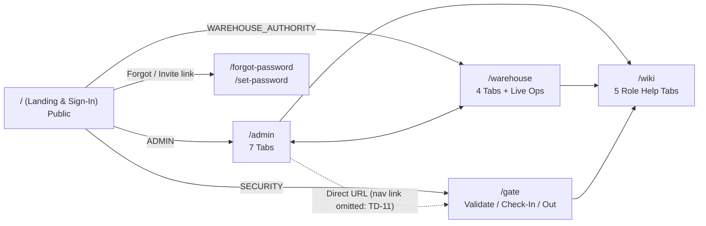

# DOC-06: User Interface (UI) Specification

| Field | Value |
|---|---|
| **Document ID** | `DOC-06` |
| **Version** | `1.0.0` |
| **Category** | 2 — Requirements & UX |
| **Repository Commit** | `445c7f965e22e7915238cca5631e68b4462d7b7b` |
| **Validation Status** | Reviewed |

---

## 1. Purpose and Scope
This document specifies the web user interface architecture, screen inventory, navigation model, interactive components, client-side JavaScript behavior, security constraints, and known UI limitations for `SetuHaul_Rescheduling_Service`.

## 2. Executive Summary
SetuHaul's production web UI is **server-rendered HTML** (Python string builders using `html.escape) enhanced with **11 vanilla ES5-style JavaScript and CSS assets**, requiring **zero build step and zero third-party frontend frameworks**. All production JS manipulates the DOM exclusively via `textContent` and DOM APIs (zero `innerHTML) under a strict Content Security Policy, with one verified CSP inline-style defect on `/gate` (`TD-07).

---

## 3. Navigation & Access Matrix

| Route | Allowed Roles | Redirect / Refusal Behavior |
|---|---|---|
| `GET /` | Public | Signed-in users auto-redirect to `/admin`, `/gate`, or `/warehouse`; OAuth errors show `/?signin=<category>`. |
| `GET /forgot-password`, `/set-password` | Public | Returns `404` when `password_login_on` is False. |
| `GET /admin` | `ADMIN` | Unauthenticated -> `/`; wrong role -> `403`. |
| `GET /warehouse` | `WAREHOUSE_AUTHORITY`, `ADMIN` | Supports `X-Live: 1` partial refresh; sets `sh_facility` cookie. |
| `GET /gate` | `SECURITY`, `ADMIN` | Facility-scoped gate screen. |
| `GET /wiki` | `ADMIN`, `WAREHOUSE_AUTHORITY`, `SECURITY` | In-app role documentation. |
| `GET /demo`, `/demo/driver` | Localhost only (`127.0.0.1`/`::1) | Never registered in production `create_app_from_env`. |

---

## 4. Screen-by-Screen Specification

### 4.1 Landing & Password Screens (`/`, `/forgot-password`, `/set-password)
- Renders active sign-in options dynamically: Google OAuth button (`/auth/login), Email & Password form (`POST /auth/password`, when enabled), and optional Break-Glass Local Admin form (`POST /auth/local-admin`, when `SETUHAUL_LOCAL_ADMIN=1).
- `/set-password` reads `#token=...` from the URL hash fragment via `password.js` and immediately scrubs the URL with `history.replaceState` so tokens never leak into server logs or `Referer` headers.

### 4.2 Warehouse Screen (`/warehouse)
- **Attention Banner**: Summarizes pending cases, facility-change requests, and failed notices.
- **4 Hash-Routed Tabs** (`tabs.js): Not present in repository.
 1. **`#board` (Dock Board + Live Operations Aside)**:
 - Facility selector (`sh_facility` cookie) + Day picker.
 - Dock-by-hour grid (`AVAILABLE`, `BOOKED`, `HELD`, `BLOCKED) with `<dialog>` detail modal and "Free this slot" action.
 - Expandable `
` panels: *On the bays now* (trucks checked in -> "Mark unloading complete"), *Block a dock* (2-step preview & commit via `exceptions.js), *Round-the-clock slots* (set `facility_crews.crews).
 - Live `Operations` sidebar with sub-views: **Cases** (claim, resolve with conditional `ASSIGNED_SLOT` slot picker), **Chats** (facility-scoped driver transcripts + send message + resend failed notices), **Requests** (pending facility changes approve/reject + partner requests).
 - **3-Second Live Polling (`warehouse.js)**: Fetches `/warehouse` with `X-Live: 1`, parses via `DOMParser`, and swaps 8 live containers while preserving focus, open `
`, scroll position, and unsent form drafts (skips swap if user is typing in a `<textarea>).
 2. **`#projects`**: Create customer contract projects (`PRJ-...) and allocate/release eligible drivers.
 3. **`#shipments`**: Open dock availability (up to 14d), create shipments (`ORD\d{6+}` + cascading facility/carrier/vehicle/slot selects), and manage passes (reissue, revoke, reassign driver, cancel, unlock).
 4. **`#drivers`**: View visible drivers (masked phone, no licence number, Telegram status), onboard new driver, revoke/allow-relink Telegram, and 2-step soft-delete driver (`exceptions.js` with name confirmation).

### 4.3 Gate Screen (`/gate)
- **Arriving Truck Validation & Check-In (`gate.js)**: Input or scan (keyboard-wedge Enter or `BarcodeDetector` + `getUserMedia` camera) Dock Access Pass + vehicle registration + licence -> `POST /v1/gate/validate` -> displays shipment/dock/window -> `POST /v1/gate/check-in` with `crypto.randomUUID` `request_key`.
- **Trucks Inside Table**: Lists `CHECKED_IN` and `OPERATIONS_COMPLETE` visits with one-click check-out (`POST /v1/gate/check-out).
- **Check-Out by Pass Form**: Alternative check-out using `DAP-...` code.

### 4.4 Admin Screen (`/admin)
- **7 Hash-Routed Tabs**: Not present in repository.
 1. **`#users`**: List non-deleted users, invite user (hides facility checkboxes when `ADMIN` selected via `admin.js), disable/enable, hybrid delete, update facilities, send invite/reset password link.
 2. **`#pending`**: Approve or reject `PENDING_APPROVAL` drivers.
 3. **`#drivers`**: Suspend or re-approve onboarded drivers.
 4. **`#deleted-drivers`**: Restore soft-deleted drivers.
 5. **`#audit`**: Filterable audit log (`actor`, `action`, `outcome`, `since`, `limit <= 500`, clear-filters link via `admin.js).
 6. **`#model`**: Local `model_turns`/`model_calls` latency/token/cost summary + on-demand LangSmith 24h loader (`model.js).
 7. **`#configuration`**: Manage `model`, `langsmith` (requires typing `SEND_TO_LANGSMITH` confirmation via `settings.js), `telegram` (secret generator, test bot, register webhook), and `email` (SMTP settings, password-login on/off switch, send test email), each with dirty-field diffing and "Reset to.env".

### 4.5 Wiki Screen (`/wiki)
- 5 static role-guide tabs (`Getting started`, `Warehouse`, `Admin`, `Gate`, `Driver chat) rendered by `auth/wiki_pages.py`.

---

## 5. Client-Side Assets Inventory

| Asset | Lines | Responsibility |
|---|---:|---|
| `common.js` | 392 | Declarative `form[data-api]` / `button[data-api]` submission, `data-confirm`, `data-dirty`, error message dictionary, `sessionStorage` flashes, `window.SH`. |
| `warehouse.js` | 405 | 3s `X-Live: 1` DOM polling, slot `<dialog>`, `ASSIGNED_SLOT` picker, cascading selects. |
| `exceptions.js` | 189 | Two-step dock-block preview/commit (`PLAN_CHANGED` retry) & driver deletion confirmation. |
| `gate.js` | 124 | Validate -> check-in flow, `request_key`, keyboard-wedge & `BarcodeDetector` camera scanning. |
| `settings.js` | 106 | Dirty-field diffing, LangSmith confirmation gate, secret generation, live test buttons. |
| `model.js` | 45 | On-demand `GET /v1/admin/model/langsmith` fetch. |
| `admin.js` | 31 | Audit clear-filters link; conditional facility checkboxes by role. |
| `tabs.js` | 26 | Hash-based tab routing (`#messages` alias -> `#board). |
| `password.js` | 24 | `#token=` fragment extraction, `history.replaceState` scrubbing, confirmation match check. |
| `tokens.css` / `app.css` | 37 / 230 | Design tokens and full UI layout/component styles. |

---

## 6. UI Security, Accessibility & Known Limitations
- **CSP Inline-Style Defect (`TD-07)**: `src/setuhaul/auth/gate_pages.py` embeds `style="max-width:320px;width:100%"` on `<video id="scan-video">`, violating `style-src 'self'`.
- **Missing Nav Link (`TD-11)**: Admin navigation bar omits `/gate` despite `ADMIN` having gate access.
- **No Auto-Refresh on Non-Board Warehouse Tabs**: `#projects`, `#shipments`, and `#drivers` require full page reload after mutations (`warehouse.js).
- **Demo Console Isolation**: `src/setuhaul/demo/index.html` uses inline scripts/styles and `innerHTML` (escaped via custom `esc), acceptable only because `/demo` is localhost-only and never registered in production.
- **Accessibility**: — no automated WCAG / keyboard-only / screen-reader audit is present in the repository.

## 7. Open Questions
- Open Questions: Are WCAG 2.1 AA compliance and mobile-tablet responsiveness for gate guards formal requirements?
