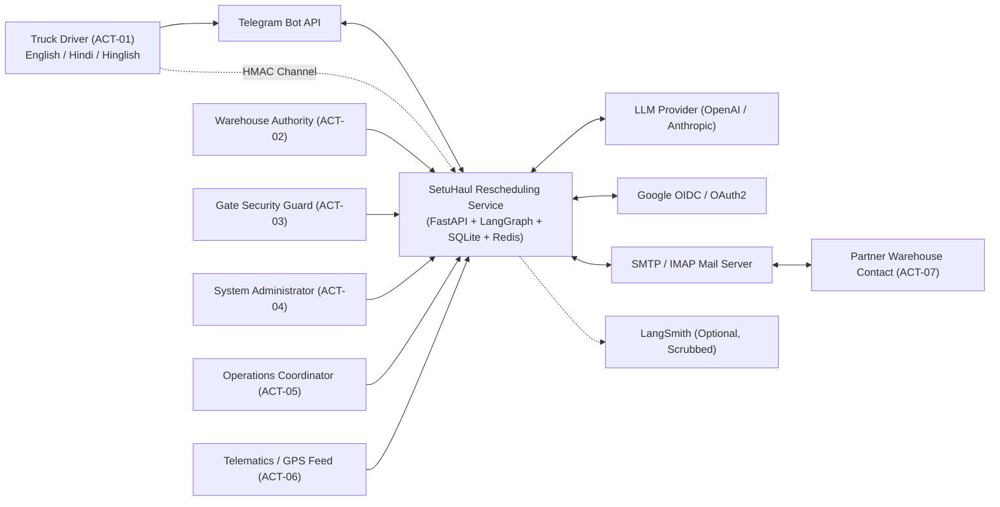
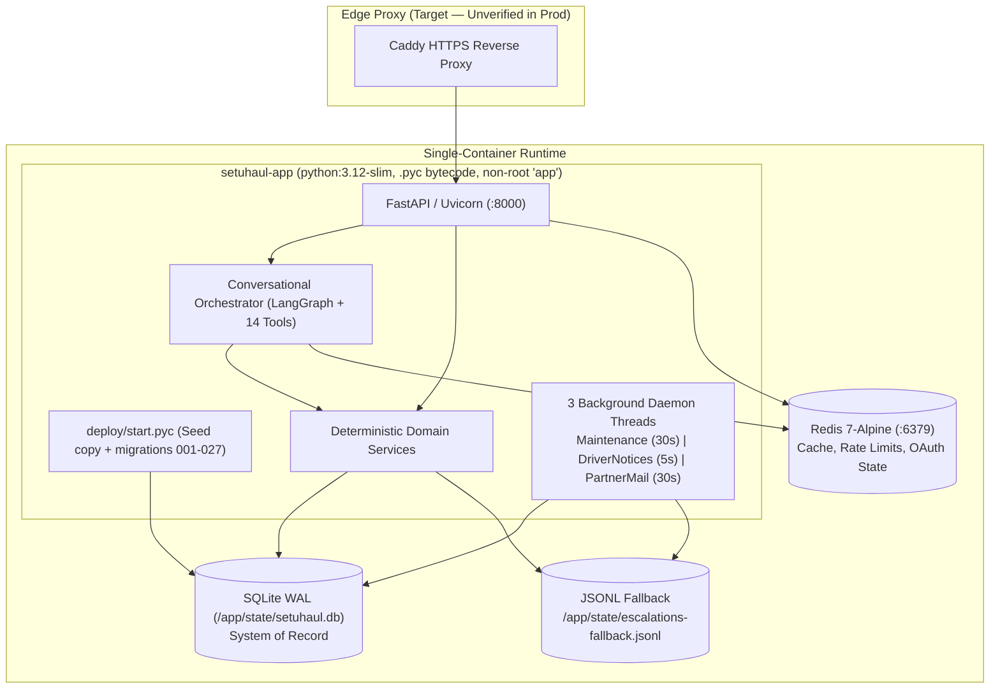

# DOC-07: Software Architecture Document (SAD) & High-Level Design (HLD)

| Field | Value |
|---|---|
| **Document ID** | `DOC-07` |
| **Version** | `1.0.0` |
| **Category** | 3 — Architecture & Design |
| **Repository Commit** | `445c7f965e22e7915238cca5631e68b4462d7b7b` |
| **Validation Status** | Reviewed |

---

## 1. Purpose and Scope
This Software Architecture Document (SAD) and High-Level Design (HLD) describes the architectural style, system context, container topology, component decomposition (`CMP-01`–`CMP-11), key architectural patterns, and quality-attribute trade-offs of `SetuHaul_Rescheduling_Service`.

## 2. Executive Summary
SetuHaul follows a **Modular Monolith with Deterministic Core & Bounded AI Boundary** architecture. A single Python 3.12 FastAPI/Uvicorn container serves HTTP APIs, server-rendered web screens, and three in-process background daemon threads (`MaintenanceRunner`, `DriverNoticeRunner`, `PartnerMailRunner), backed by SQLite in WAL mode as the transactional system of record and Redis 7 for disposable caches, rate limits, and single-use OAuth state.

The defining architectural principle is **strict separation of probabilistic language understanding from deterministic state control**: the LLM (via LangGraph + provider-neutral `ModelGateway) interprets natural language and invokes 14 narrow Pydantic-validated tools, while deterministic Python + SQLite unique constraints enforce identity, ETA math, 5-gate feasibility, FCFS holds, atomic swaps, pass verification, and escalation.

---

## 3. C4 System Context

*(Editable Mermaid source: [`docs/enterprise/diagrams/01-c4-context.mmd`](../diagrams/01-c4-context.mmd))*

---

## 4. C4 Container Architecture

*(Editable Mermaid source: [`docs/enterprise/diagrams/02-c4-container.mmd`](../diagrams/02-c4-container.mmd))*

---

## 5. Component Architecture (`CMP-01`–`CMP-11)

*(Editable Mermaid source: [`docs/enterprise/diagrams/03-c4-component.mmd`](../diagrams/03-c4-component.mmd))*

| Component ID | Name | Primary Modules | Responsibilities |
|---|---|---|---|
| `CMP-01` | FastAPI HTTP & Web Application | `api.py`, `auth/*_routes.py`, `auth/*_pages.py`, `auth/assets/*` | HTTP routing, body caps, SSR HTML, static asset whitelist, lifespan wiring. |
| `CMP-02` | Conversational Orchestrator & LangGraph Loop | `conversation.py`, `model_gateway.py`, `prompts.py`, `tools.py`, `language.py`, `memory.py` | Bounded LangGraph loop, 14 narrow tools, write-intent checkpoints, trilingual templates, output claim/leak guards. |
| `CMP-03` | ETA, GPS & Feasibility Engine | `eta.py`, `gps.py`, `travel.py`, `position.py`, `capacity.py`, `feasibility.py`, `allocation.py`, `option_history.py` | Multi-source ETA, GPS arrival floor, 5-gate slot evaluation, FCFS ranking, option reconciliation. |
| `CMP-04` | Booking, Holds, Cancellation & Warehouse Ops | `booking.py`, `cancellation.py`, `release.py`, `assign.py`, `round_clock.py`, `dock_blocks.py`, `board.py` | Atomic hold/confirm/cancel transactions, 24/7 14d horizon, dock blocks with auto-move, dock board. |
| `CMP-05` | Facility Change & Partner Email Subsystem | `facility_change.py`, `partner_booking.py`, `mail_transport.py`, `mailcfg.py` | Destination-approved moves with auto-revert; SMTP/IMAP partner booking with SPF/DKIM/DMARC checks. |
| `CMP-06` | Dock Access Pass & Gate Control Subsystem | `dock_pass.py`, `passes.py`, `pass_check.py`, `gate.py`, `order_numbers.py` | 128-bit hashed `DAP-...` issuance/redaction, chat confirmation lockout, 8-step gate validation, check-in/out. |
| `CMP-07` | Escalation, Outbox & Notification Subsystem | `escalation.py`, `coordinator.py`, `events.py`, `notifications.py`, `driver_messages.py`, `chat_loads.py` | Deduplicated escalation queue, CLI, fsync JSONL fallback, transactional outbox, load-scoped chat visibility. |
| `CMP-08` | Authentication, RBAC, Settings & Audit | `identity.py`, `rate_limit.py`, `app_settings.py`, `runtime_settings.py`, `retention.py`, `auth/*` | Google OIDC, email/password, break-glass admin, Telegram binding, facility RBAC, Fernet config, audit & retention. |
| `CMP-09` | Background Maintenance & Delivery Runners | `jobs/expire_holds.py`, `jobs/send_driver_notifications.py`, `jobs/partner_mail.py`, `webhook_startup.py` | Hold expiry, fallback ingestion, gate overstay sweep, 24/7 slot top-up, Telegram backoff, partner mail polling. |
| `CMP-10` | SQLite Persistence & Migrations Layer | `db.py`, `repositories.py`, `migrations/001-027` | WAL connections, `BEGIN IMMEDIATE` serialization, atomic schema migrations with FK verification. |
| `CMP-11` | Observability, Evaluation & Integrity Harness | `observability.py`, `langsmith_trace.py`, `model_usage.py`, `evaluation.py`, `integrity.py`, `proof.py` | Redacted JSON logging, model cost/latency tables, scrubbed LangSmith, trace replay, 12 DB invariants, contention proofs. |

---

## 6. Key Architectural Patterns & Trade-Offs
1. **Transactional Outbox + Database-Level Capacity Lock**: Holds live in `appointments` under `ux_active_appointment_per_slot`, eliminating distributed-lock bugs and guaranteeing atomic hold->confirm swaps.
2. **Injectable Clock (`Clock` Protocol)**: All services accept `Clock` (`SystemClock` / `FakeClock), enabling deterministic testing of TTLs, cutoffs, rate limits, and 24/7 horizons.
3. **Disposable Cache, Durable SQL**: Redis caches conversation windows and rate limits, but SQLite is always authoritative for `ConversationState`, `auth_sessions`, and holds.
4. **Single-Process Scaling Ceiling (Trade-off, `TD-01)**: SQLite + in-process daemon threads + in-memory backoff/locks restrict deployment to **1 Uvicorn worker**. Saturation tests show ~244 holds/s ceiling and p99 lock waits reaching 4.2s at 16 concurrent writers, defining clear triggers for PostgreSQL + external job queue migration (`DOC-20).

## 7. Assumptions & Open Questions
- Open Questions: Target high-availability / RTO / RPO requirements and PostgreSQL migration timeline (`DOC-23).
