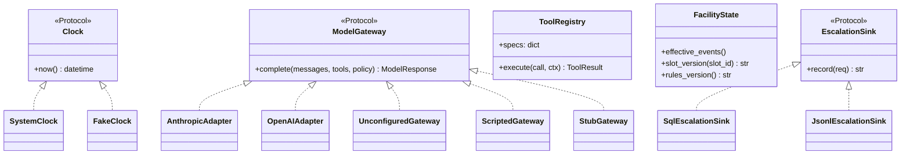
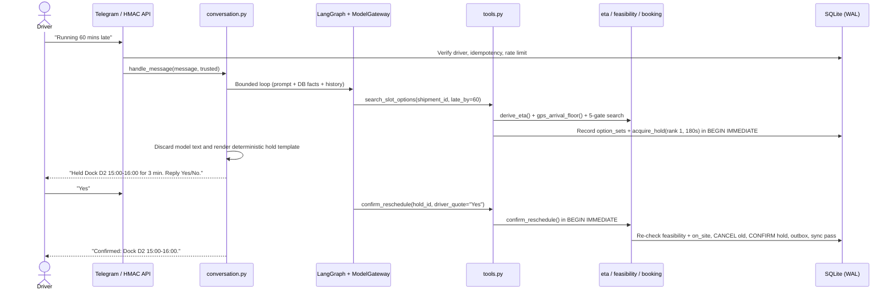

# DOC-08: Low-Level Design (LLD)

| Field | Value |
|---|---|
| **Document ID** | `DOC-08` |
| **Version** | `1.0.0` |
| **Category** | 3 — Architecture & Design |
| **Repository Commit** | `445c7f965e22e7915238cca5631e68b4462d7b7b` |
| **Validation Status** | Verified against `src/setuhaul/` |

---

## 1. Purpose and Scope
This Low-Level Design (LLD) details the internal algorithms, class hierarchies, state machines, sequence interactions, concurrency controls, and LLM tool contracts across the core modules of `SetuHaul_Rescheduling_Service`.

## 2. Executive Summary
Core scheduling, conversational orchestration, Dock Access Pass lifecycle, and concurrency control are implemented with explicit type safety (`mypy --strict`), Pydantic v2 validation (`extra="forbid"`), pessimistic SQLite `BEGIN IMMEDIATE` write locks, optimistic `row_version`/`expected`-plan checks, and idempotency keys (`[Verified]`).

---

## 3. Core Class & Protocol Structure `[Verified]`

*(Editable Mermaid source: [`docs/enterprise/diagrams/12-class-domain-core.mmd`](../diagrams/12-class-domain-core.mmd))*

---

## 4. Detailed Subsystem Designs `[Verified]`

### 4.1 Conversational Orchestrator & Bounded LangGraph Loop (`conversation.py`, `model_gateway.py`, `tools.py`)
- **Entry (`conversation.py:153-185`)**: `handle_message()` runs `facility_change.settle()` before and after `_handle()`, persists driver text first, reconciles live holds via `ConversationMemoryStore.load()`, checks language (`en/hi/hinglish`), builds DB-verified `_facts()`, and runs `run_bounded_loop()`.
- **LangGraph State Machine (`model_gateway.py:539-655`)**:
  - Two nodes: `model` (`call_model`) and `tools` (`run_tools`), with conditional edges `after_model` / `after_tools` terminating on any non-empty `state["status"]` and a LangGraph `recursion_limit = 2 * max_rounds + 10`.
  - Caps enforced **before** each call: `max_rounds=6` (`ROUND_CAP`), `request_deadline_s=30.0` (`DEADLINE`), `cost_budget_usd=0.05` (`BUDGET`), `max_tool_executions=4` (`TOOL_CAP`, counting only `result.executed == True`).
  - `complete_with_retry()` retries `TransientModelError`/`ModelTimeout` once (`retries=1`); `PermanentModelError` never retries.
  - `disable_external_tracing()` overwrites LangChain/LangSmith env vars at loop start so tracing only occurs via the scrubbed `LangChainTracer`.
- **ToolRegistry Checkpoints (`tools.py:1024-1079`)**:
  1. Allowlist + dynamic `spec.available(ctx)` predicate (e.g., `confirm_reschedule` requires a live hold from a **prior** `message_id` and no pending cancel).
  2. Pydantic `_Args(extra="forbid")` validation (blocks model-invented `driver_id`/`thread_id`).
  3. Write tools (`spec.write=True`): verbatim normalized `driver_quote` present in `ctx.message_text` (`APPROVAL_NOT_PRESENT`) and `ctx.turn.writes_done < 1` (`ONE_WRITE_PER_MESSAGE`).
  4. Deterministic output rendering (`_finalize`, `conversation.py:408-523`): any committed action discards LLM text and renders `language.say(...)`; unbacked model claims (`claims_confirmed`, `claims_held`, `leaks_prompt`) are replaced by `_guard()`.

#### Registered LLM Tools (`REGISTRY`, `src/setuhaul/tools.py:918-1002`) `[Verified]`

| # | Tool Name | `write` | Availability Predicate | Pydantic Args | Purpose & Side Effects |
|---|---|---|---|---|---|
| 1 | `list_my_shipments` | `False` | Always | `NoArgs` | Lists authenticated driver's active shipments from `v_driver_shipments`. |
| 2 | `get_shipment_status` | `False` | Always | `ShipmentArgs` | Returns planned/current ETA, appointment, gate check-in, and `untrusted_text` notes; records confirmed times for `_guard()`. |
| 3 | `compute_eta` | `False` | Always | `ComputeEtaArgs` | Derives arrival ETA (`late_by`, `repair`, `explicit_eta`) with gate and GPS cross-checks. |
| 4 | `search_slot_options` | `False`\* | Always | `SearchArgs` | Evaluates feasible slots (up to 3), records `option_sets`, and auto-holds rank 1 via `_auto_hold`. |
| 5 | `compare_option_set` | `False` | `_has_option_set` | `CompareArgs` | Reconciles a previously shown option set against live facility state (`FOREIGN_OPTION_SET` enforced). |
| 6 | `offer_original_slot` | `False`\* | Always | `ShipmentArgs` | Re-evaluates a previously replaced slot and auto-holds it if feasible. |
| 7 | `request_hold` | `True` | `_has_option_set` | `HoldArgs` | Acquires temporary hold on rank `1`–`3` of the latest option set (`supersede=True`). |
| 8 | `confirm_reschedule` | `True` | `_can_confirm` | `ConfirmArgs` | Enforces `agrees_to_confirm()` and atomically swaps old appointment (`CANCELLED`) and prior-turn hold (`CONFIRMED`). |
| 9 | `decline_held_slot` | `True` | `_can_confirm` | `QuoteArgs` | Rejects agreement-like messages (`AMBIGUOUS`), releases current hold, and auto-holds next unoffered feasible slot (or escalates `NO_SLOT`). |
| 10 | `request_facility_change` | `True` | Always | `FacilityChangeArgs` | Creates a `PENDING` destination facility-change request (`120m` TTL) for destination warehouse approval. |
| 11 | `release_pending_change` | `True` | `_has_hold` | `ShipmentQuoteArgs` | Releases pending hold while leaving the original appointment untouched. |
| 12 | `cancel_appointment` | `True` | Always | `ShipmentQuoteArgs` | Two-turn confirmed cancellation: turn 1 previews & sets `PendingCancel` (`10m`); turn 2 verifies `agrees_to_cancel()` then cancels or escalates. |
| 13 | `request_partner_slot` | `True` | `_has_partner_shipment` | `PartnerSlotArgs` | Queues a `PENDING_PARTNER` email slot request for an open load bound to an `is_partner=1` facility. |
| 14 | `escalate_to_operations` | `False` | Always | `EscalateArgs` | Hands conversation off to human operations (`SAFETY`, `REGULATED_LOAD`, `POLICY_CONFLICT`, `DRIVER_REQUESTED`, `OTHER_UNCERTAINTY`). |

*\*`search_slot_options` and `offer_original_slot` have `write=False` in `REGISTRY` (bypassing `driver_quote`), though they persist `option_sets` and invoke `_auto_hold` (see `TD-05`).*

### 4.2 Driver Rescheduling Sequence (`DOC-03` / `booking.py`)
*(Editable Mermaid source: [`docs/enterprise/diagrams/04-seq-driver-reschedule.mmd`](../diagrams/04-seq-driver-reschedule.mmd))*

### 4.3 Five-Gate Feasibility & Option Reconciliation (`capacity.py`, `feasibility.py`, `option_history.py`)
- `build_facility_state()` loads slots in `[now - 2d, now + 30d]` UNION active appointments, excludes expired holds (`expires_epoch <= as_of`), resolves open-ended `dock_status_events` via `REOPENED` or `dock_blocks.ended_at`, and computes SHA-256 `slot_version` (16 hex) and `rules_version` (`R1-` + 10 hex).
- `evaluate_slot()` executes Gates 0–4 sequentially (`STALE_FACILITY_STATE` -> 17 hard rules -> `INCOMPLETE_FEASIBILITY_DATA` -> contiguous labour/equipment & crew count -> consignee commitment deadline).
- `rank_options()` sorts `FEASIBLE` slots deterministically by `(slot_start, dock_code, slot_id)`.

### 4.4 Dock Access Pass & Gate Control Sequence (`passes.py`, `pass_check.py`, `gate.py`)
*(Editable Mermaid source: [`docs/enterprise/diagrams/05-seq-dock-access-pass-gate.mmd`](../diagrams/05-seq-dock-access-pass-gate.mmd))*
- Pass code: `DAP-XXXXX-XXXXX-XXXXX-XXXXX-XXXXXX` (128 random bits, base32, SHA-256 stored only).
- `gate._assess()` evaluates 8 refusal checks in strict deterministic order; `check_in` uses optimistic `row_version` on `dock_access_authorizations` and idempotency via `truck_visits.check_in_key` (and `check_out_key` for check-out).

### 4.5 Domain State Machines `[Verified]`
*(Editable Mermaid source: [`docs/enterprise/diagrams/08-state-machines.mmd`](../diagrams/08-state-machines.mmd))*
- **Appointments**: `HELD -> CONFIRMED | CANCELLED`; `CONFIRMED -> CANCELLED | IN_PROGRESS | COMPLETED`; `IN_PROGRESS` cannot be rescheduled/cancelled/freed.
- **Dock Access Passes**: `ISSUED -> VALIDATED -> ACTIVE -> COMPLETED -> CLOSED` (plus `EXPIRED`, `REVOKED`, `CANCELLED`; `EXPIRED -> ISSUED` allowed on `sync_window` if visit `EXPECTED`).
- **Truck Visits**: `EXPECTED -> CHECKED_IN -> OPERATIONS_COMPLETE -> CHECKED_OUT` (or `CANCELLED`).
- **Escalations**: `OPEN -> CLAIMED -> RESOLVED -> OPEN` (reopen $\le 24\text{h}$), or `OPEN/CLAIMED -> CANCELLED`.
- **Facility Changes**: `PENDING -> APPROVED (WAITING -> BOOKED | REJECTED)` or `REJECTED | EXPIRED`.
- **Partner Requests**: `PENDING_PARTNER -> APPROVED | DECLINED | EXPIRED | FAILED`.

---

## 5. Concurrency & Transaction Design `[Verified]`
- **Write Serialization**: All mutations execute inside `with immediate(conn):` (`BEGIN IMMEDIATE`, `5000ms` busy timeout); `OperationalError("locked"/"busy")` maps to `OutcomeClass.LOCK_TIMEOUT` (`booking.py:139-142,322-323`).
- **Idempotency**: `inbound_messages(driver_id, message_id)` for HTTP turns; `idempotency_keys(driver_id, thread_id, message_id, action)` with SHA-256 fingerprint for `confirm_reschedule` and `cancel_confirmed_appointment`; `partner_inbound(message_id)` for IMAP replies; `truck_visits.check_in_key`/`check_out_key` for gate operations.
- **No Network I/O Inside Transactions**: Telegram API calls, SMTP sends, and JSONL fallback writes execute strictly outside `immediate(conn)` blocks.

## 6. Source Evidence, Known LLD Defects & Open Questions
- Known LLD defects tracked in `DOC-20`: `TD-02` (divergent on-site predicates), `TD-05` (`writes_done` / `evaluation.WRITE_TOOLS`), `TD-06` (stale 15m buffer in `option_sets.context_json`), `TD-08` (`board.py`/`assign.py` expired-hold leaks & `KeyError` in `request_original_slot_again`), `TD-09` (`PartnerMailRunner` success marking).
- Open Questions: None beyond `DOC-23` operational thresholds.
