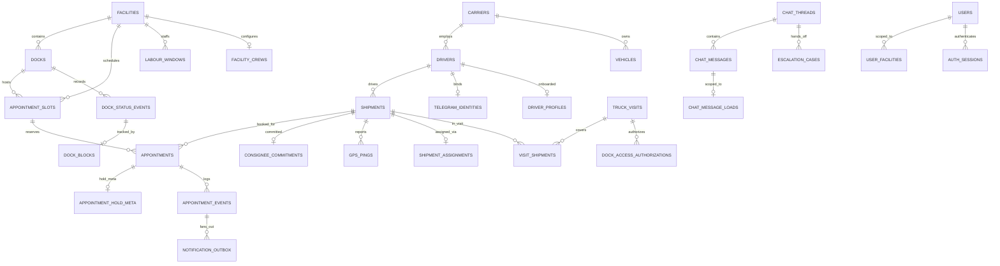

# DOC-10: Data Architecture Specification

| Field | Value |
|---|---|
| **Document ID** | `DOC-10` |
| **Version** | `1.0.0` |
| **Category** | 3 — Architecture & Design |
| **Repository Commit** | `445c7f965e22e7915238cca5631e68b4462d7b7b` |
| **Validation Status** | Reviewed |

---

## 1. Purpose and Scope
This document specifies the data architecture of `SetuHaul_Rescheduling_Service`: base seed schema (18 tables, 4 views, 7 indexes), all 27 incremental migrations (`001`–`027), entity relationships, shared capacity constraints, SQLite transactional settings, immutability triggers, data retention, and soft-deletion/erasure semantics.

## 2. Executive Summary
SQLite (bundled with Python 3.12, WAL mode, `PRAGMA foreign_keys=on`, `busy_timeout=5000ms`, `BEGIN IMMEDIATE` write transactions) is the authoritative system of record. The pristine seed database (`data/setuhaul.sqlite3) is SHA-256 pinned (`C02806E60827CA41C123D80E317F09ABB5585B870111F4C2CFE2177273F90700) and immutable; working copies receive 27 ordered SQL migrations adding 33+ tables, 1 view (`v_driver_shipments), 6 immutability triggers, and 9 partial/expression unique indexes.

---

## 3. Core Entity Relationship Diagram

*(Editable Mermaid source: [`docs/enterprise/diagrams/07-erd-core-data-model.mmd`](../diagrams/07-erd-core-data-model.mmd))*

---

## 4. Schema Inventory

### 4.1 Base Seed Schema (`data/setuhaul.sqlite3` — 18 Tables, 4 Views)
- **Parties**: `carriers`, `drivers`, `vehicle_types`, `vehicles`.
- **Facilities & Capacity**: `facilities` (2: `FAC-JAI-01`, `FAC-GGN-01), `docks`, `dock_status_events`, `facility_rules`, `facility_contacts`, `appointment_slots`, `appointments` (20; rebuilt in `002` to add `'HELD').
- **Shipments & Arrivals**: `shipments`, `eta_updates`, `facility_checkins`.
- **Conversation & Ops**: `chat_threads`, `chat_messages`, `driver_exceptions`, `operational_messages` (5; never written by prototype).
- **Base Views**: `v_latest_eta`, `v_slot_availability` (rebuilt `002), `v_inbound_operational_state` (rebuilt `002), `v_current_facility_queue`.
- **Known Seed Anomalies **: 2 overweight active bookings (`SHP1005`/`D3`, `SHP1014`/`D1), 6 unmeetable ETAs, 4 loads with unload > 60m slot, 3 appointments overlapping dock events, 4 open shipments without bookings, 4 drivers with 2 open shipments, and **0 labour/consignee rows**.

### 4.2 Migrations 001–027 Summary
| Domain | Migrations | Tables / Views / Key Changes Added |
|---|---|---|
| **Scheduling, Holds & Capacity** | `001`, `002`, `006`, `026` | `option_sets`, `option_set_items` (CASCADE); rebuild `appointments` (+`'HELD'), `appointment_hold_meta`; `labour_windows`, `consignee_commitments`; capacity window indexes (`026). |
| **Events, Outbox & Idempotency** | `003`, `007`, `008`, `021`, `023` | `appointment_events` (immutable triggers), `notification_outbox` (rebuilt `023` for nullable `event_id` + `shipment_id), `maintenance_runs`, `idempotency_keys`, `inbound_messages`, `chat_message_loads` (CASCADE). |
| **Escalations** | `004` | `escalation_cases`, `escalation_events` (immutable triggers), `ux_active_case_per_key`. |
| **Identity, Auth, Roles & Projects** | `005`, `011`, `012`, `017`, `020` | `channel_identities`, `driver_sessions`, `conversation_state`; `users` (rebuilt `017` +`SECURITY), `user_facilities`, `auth_sessions` (rebuilt `020` +`PASSWORD), `admin_credentials`, `driver_profiles`, `telegram_identities`, `projects`, `project_drivers`, `ux_projects_contract_ref_nocase`, `account_links`. |
| **GPS, Partner & Facility Change** | `009`, `010`, `013` | `gps_pings` + `facilities.lat/lon`; `facilities.is_partner`, `partner_requests`, `partner_inbound`; `facility_change_requests`. |
| **Shipments, Passes & Gate** | `016` | `shipment_assignments`, `v_driver_shipments` view, `truck_visits`, `visit_shipments`, `dock_access_authorizations`, `ux_live_pass_per_visit`. |
| **Dock Blocks & 24/7 Crews** | `018`, `022` | `dock_blocks`, `facility_crews`. |
| **Telemetry & Runtime Config** | `014`, `015` | `model_turns`, `model_calls`, `app_settings`. |
| **Audit, Lockouts & Deletions** | `011`, `019`, `024`, `025`, `027` | `audit_log` (immutable triggers; `025` allows `ip = NULL` retention scrub only), `driver_deletions`, `auth_ip_lockouts`, `user_deletions`. |

---

## 5. Critical Integrity Constraints & Triggers

### 5.1 Shared Capacity Constraints
1. `ux_active_appointment_per_slot`: `UNIQUE ON appointments(slot_id) WHERE appointment_status IN ('PENDING_CONFIRMATION','CONFIRMED','IN_PROGRESS','HELD')` — enforces at most one active booking OR hold per slot.
2. `ux_current_active_appointment_per_shipment`: `UNIQUE ON appointments(shipment_id) WHERE is_current = 1 AND appointment_status IN ('PENDING_CONFIRMATION','CONFIRMED','IN_PROGRESS')`.
3. `ux_one_hold_per_shipment`: `UNIQUE ON appointments(shipment_id) WHERE appointment_status = 'HELD'`.

### 5.2 Immutability Triggers
- `appointment_events_no_update`, `appointment_events_no_delete` (`003:36-39)
- `escalation_events_no_update`, `escalation_events_no_delete` (`004:64-67)
- `audit_log_no_delete` (`011:109-112) and `audit_log_no_update` (`025:6-20`, permits `SET ip = NULL` only)

---

## 6. Migration Engine, Retention & Soft-Deletion
- **Migrations **: Tracked in `schema_migrations(filename, applied_at)`. Each `.sql` file runs with `PRAGMA foreign_keys=off` inside an explicit `BEGIN... COMMIT` transaction, followed by `PRAGMA foreign_key_check` before commit and `PRAGMA foreign_keys=on` in `finally`.
- **Retention **: Option sets purge every 24h (`30d` TTL). Extended retention is **OFF by default** (`SETUHAUL_RETENTION_ENABLED=1), running in 500-row batches: `chat_messages` (90d, skipping open cases/live holds), `gps_pings` (30d), `audit_log.ip` -> `NULL` (90d), `inbound_messages` `DONE` (30d), `model_calls`/`model_turns` (90d).
- **Soft-Delete & Erasure**: Not present in repository.
 - Drivers: soft-deleted via `driver_deletions` (cancels open loads/holds/passes, revokes Telegram, sets `INACTIVE`; restorable by Admin); PII erasure via `erase_driver_data` scrubs `drivers` fields to `ERASED` to preserve FKs.
 - Web Users: hard-deleted if unreferenced in 11 FK history columns; otherwise soft-deleted (`DISABLED`, email rewritten to `deleted+<id>@deleted.invalid`, original recorded in `user_deletions).

## 7. Discrepancies & Open Questions
- Discrepancies detected: Rollback comments in `migrations/024`, `025`, `026` reference `schema_migrations WHERE version=...` instead of `filename` (`GAP-10); `026:13` re-declares `ix_chat_message_loads_facility` with `IF NOT EXISTS` (no-op over `021:11).
- Open Questions: What are the legal retention periods per table, and what is the trigger timeline for migrating from SQLite to PostgreSQL (`DOC-23)?
