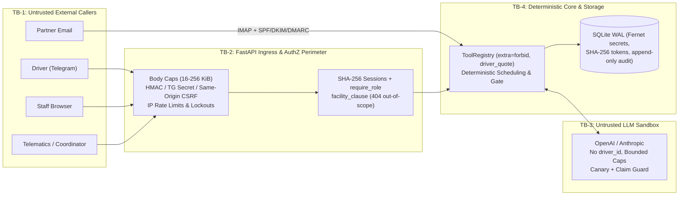

# DOC-12: Security Architecture & Threat Model

| Field | Value |
|---|---|
| **Document ID** | `DOC-12` |
| **Version** | `1.0.0` |
| **Category** | 4 — Security, Privacy & Governance |
| **Repository Commit** | `445c7f965e22e7915238cca5631e68b4462d7b7b` |
| **Validation Status** | Reviewed |

---

## 1. Purpose and Scope
This document defines the Security Architecture, Trust Boundaries, Authentication/Authorization controls, Cryptographic protections, AI/Prompt-Injection defenses, and STRIDE Threat Model for `SetuHaul_Rescheduling_Service`.

## 2. Executive Summary
SetuHaul implements strong defense-in-depth for a prototype: server-side RBAC with `404` out-of-scope masking, HMAC-SHA256 channel verification over raw bytes, `scrypt` password hashing with dummy-hash timing protection and per-IP + global lockouts, Fernet encryption for runtime secrets, SHA-256 hashing of sessions/passes/tokens, strict HTML CSP, append-only scrubbed audit logging, and deterministic LLM output/write checkpoints.

However, reverse-engineering identified **concrete security gaps** requiring remediation before production: a CSP inline-style violation on `/gate` (`TD-07), missing `Content-Type`/body-cap on `/auth/local-admin` (`TD-07), missing client IP in most audit entries (`TD-11), same-origin middleware permitting requests lacking both `Origin` and `Sec-Fetch-Site`, absent JSON API security headers & HSTS, unverified Google ID token JWKS signatures, fail-open driver rate limiting, and zero live-LLM prompt-injection testing (`RSK-01`, `RSK-07).

---

## 3. Data Flow & Security Trust Boundaries

*(Editable Mermaid source: [`docs/enterprise/diagrams/09-data-flow-and-security-trust-boundaries.mmd`](../diagrams/09-data-flow-and-security-trust-boundaries.mmd))*

---

## 4. Security Controls Inventory

| Control Area | Mechanism | Configuration / Strength |
|---|---|---|
| **Web AuthN** | Google OIDC + PKCE (`S256) + Redis single-use state (`600s); Email/Password (`scrypt` $N=2^{14},r=8,p=1$, 16B salt, min 12 chars); Break-glass Local Admin | Sessions: 32B random token, SHA-256 in `auth_sessions`, `HttpOnly`, `SameSite=Lax`, `Secure` on HTTPS, TTL `8h` (`1h` local admin). |
| **Channel AuthN** | Telegram `X-Telegram-Bot-Api-Secret-Token` ($\ge 16$ chars) + self-contact phone binding (sticky revoke); HMAC-SHA256 (`X-Signature) over raw bytes; Coordinator Bearer tokens (`hmac.compare_digest) | Body caps: `64 KiB` msgs, `16 KiB` GPS/status, `256 KiB` Telegram; `±300s` replay window on `/v1/driver/status`. |
| **Authorization** | Server-side `require_role(*roles)` + `facility_clause` / `assert_facility`; live user re-read on every request | Roles: `ADMIN`, `WAREHOUSE_AUTHORITY`, `SECURITY`; out-of-scope probes return `404` + audit log. |
| **CSRF & Headers** | `same_origin_only` middleware (`Sec-Fetch-Site` / `Origin` vs `SETUHAUL_PUBLIC_URL); HTML `SECURITY_HEADERS` (`CSP`, `nosniff`, `no-referrer`, `no-store`, `frame-ancestors 'none') | Zero `innerHTML` in production JS; `html.escape(..., quote=True)` in SSR; `#token=` URL fragment scrubbed via `history.replaceState`. |
| **Secrets & Crypto** | Fernet (`cryptography==50.0.2) encryption of 5 runtime secrets via `SETUHAUL_SETTINGS_KEY`; SHA-256 of passes (`128-bit), sessions, and invite/reset links | Secrets masked in API (`set` + `last4); `hide_input_in_errors=True`; unreadable secrets fail safe to `""`. |
| **Brute-Force & Abuse** | Per-(user, IP) lockout (`5` fails / `15m) + global lockout (`20` fails); Auth IP rate limit (`10` req / `15m` + in-process fallback); Gate limit (`10` fails / `15m`, fail-closed); Driver msg limit (`20/m`, `100/h); Pass chat lock (`5` guesses) | Trusted proxy IP extraction right-to-left via `SETUHAUL_TRUSTED_PROXIES`. |
| **AI / Prompt Injection** | Per-process random `PROMPT_CANARY`, static line leak check, `extra="forbid"` tool schemas, verbatim `driver_quote` write check, max 1 write/msg, prior-turn-only confirm, deterministic templates for committed state, output claim guard | Hard loop caps (`6` rounds, `4` tools, `8s`, `30s`, `$0.05); LangSmith PII/secret scrubbers. |
| **Audit Trail** | Append-only `audit_log`, `appointment_events`, `escalation_events` enforced by SQLite triggers | `audit.scrub` strips 13 credential keys on write & read; `025` allows `ip = NULL` retention scrub only. |

---

## 5. STRIDE Threat Model

| Category | Threat Scenario | Existing Mitigation | Residual Risk / Gap |
|---|---|---|---|
| **Spoofing** | Attacker spoofs driver phone or Telegram contact | HMAC-SHA256 over raw body; Telegram `contact.user_id == from.id`; sticky revoke. | `[Medium]` No rate limit on `/v1/telegram/webhook` or `/v1/gps/pings` (`RSK-07). |
| **Spoofing** | Spoofed partner email approves fake dock slot | Active contact match + `Authentication-Results` (`mx.google.com) + `dmarc=pass` or aligned `dkim=pass`. | `[Medium]` Never verified against live Gmail/SMTP/IMAP (`RSK-03). |
| **Tampering** | Prompt injection tricks LLM into confirming/cancelling or leaking prompt | `extra="forbid"`, `driver_quote`, prior-turn confirm, deterministic wording, canary + claim guard. | `[High]` Never tested against a real LLM (`RSK-01); `tools.py` `writes_done` omits `"REQUESTED"` (`TD-05). |
| **Tampering** | Cross-site request forgery on web mutations or `/auth/local-admin` | `SameSite=Lax`, `same_origin_only` middleware, JSON content-type on `/auth/password*`. | `[Medium]` `/auth/local-admin` lacks `Content-Type` check & body cap (`TD-07); `same_origin_only` allows missing `Origin` + `Sec-Fetch-Site` (`RSK-07). |
| **Repudiation** | Staff denies performing sensitive admin/warehouse action | Append-only `audit_log` with `no_delete` trigger. | `[Medium]` Most authenticated routes pass `ip=None` to `audit.record` (`TD-11). |
| **Information Disclosure** | Cross-facility probing, XSS, secret leakage, or DB theft | `404` out-of-scope masking, HTML CSP, Fernet secrets, `hide_input_in_errors`. | `[High]` No SQLite encryption at rest (`RSK-04); CSP inline-style violation on `/gate` (`TD-07); no `Cache-Control: no-store` on JSON APIs; `sh_facility` cookie lacks `Secure` (`TD-11). |
| **Denial of Service** | Flood of driver messages, login attempts, or DB lock contention | Body caps, auth IP rate limits, 5s busy timeout, JSONL fallback. | `[Medium]` Driver rate limit fails open on Redis outage; `AuthRateLimitFallback` resets at 10k keys; unbounded `driver_locks`/`_PASS_LOCKS` (`TD-12). |
| **Elevation of Privilege** | Warehouse user accesses another facility or Admin endpoints; Coordinator Bearer token abuses unscoped access | Server-side `require_role`, `facility_clause`, Bearer cannot pass `slot_id`. | `[Medium]` Coordinator Bearer tokens are unscoped across all facilities and require restart to rotate. |

---

## 6. Penetration Test Status & Open Questions
- Penetration test status: — no external penetration test or SAST/DAST scan has been executed.
- Open Questions: Is Google ID token JWKS verification required by enterprise security policy? Should Coordinator Bearer tokens be scoped per facility and rotatable at runtime? (`DOC-23).
