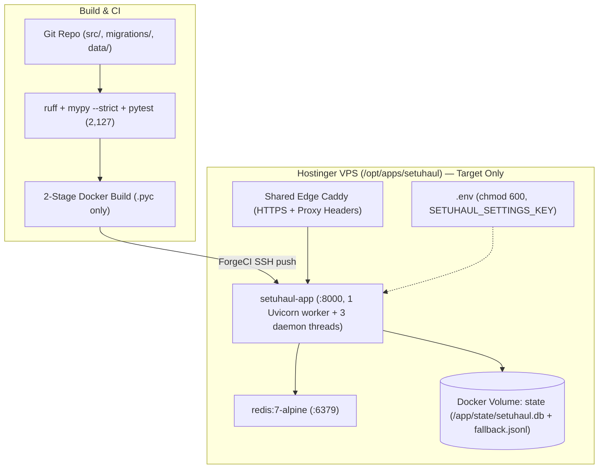

# DOC-16: Deployment Architecture, Installation Guide, Configuration Guide & CI/CD Documentation

| Field | Value |
|---|---|
| **Document ID** | `DOC-16` |
| **Version** | `1.0.0` |
| **Category** | 6 — Deployment & Operations |
| **Repository Commit** | `445c7f965e22e7915238cca5631e68b4462d7b7b` |
| **Validation Status** | Verified against `Dockerfile`, `docker-compose.yml`, `.env.example`, `.github/workflows/ci.yml`, `deploy/start.py`, and `docs/deployment-hostinger.md` |

---

## 1. Purpose and Scope
This document specifies the Deployment Architecture, Local & Container Installation Guide, Environment & Runtime Configuration Guide, and CI/CD pipeline for `SetuHaul_Rescheduling_Service`.

## 2. Executive Summary
SetuHaul packages as a two-stage `python:3.12-slim` Docker image containing compiled `.pyc` bytecode only (source `.py` files deleted in build stage), running as non-root user `app` alongside `redis:7-alpine` with a persistent Docker volume `/app/state` (`[Verified]`, `Dockerfile:1-33`, `docker-compose.yml:1-22`). Target deployment is a single-container Hostinger VPS behind shared edge Caddy via ForgeCI (`ssh-compose`), **which has never been executed in production** (`[Unverified]`, `docs/deployment-hostinger.md:7`).

---

## 3. Deployment Architecture `[Verified / Unverified in Prod]`

*(Editable Mermaid source: [`docs/enterprise/diagrams/10-deployment-and-integration.mmd`](../diagrams/10-deployment-and-integration.mmd))*



- **Strict Single-Process Constraint (`TD-01`)**: Must run exactly **1 Uvicorn worker** (`docs/deployment-hostinger.md:174`); multiple workers would duplicate Telegram notices (`DriverNoticeRunner`) and partner emails (`PartnerMailRunner`) and split in-memory locks/rate-limit fallbacks.
- **Startup Bootstrap (`deploy/start.py`)**: On container start, if `/app/state/setuhaul.db` is absent, atomically copies `/app/data/setuhaul.sqlite3` via `.partial` rename, runs `apply_migrations()` (`001`–`027`), and runs `provision_identities()`.
- **Docker Healthcheck (`Dockerfile:26-27`)**: Polls `http://127.0.0.1:8000/ready` every 15s (timeout 5s, start-period 30s, 3 retries).

---

## 4. Installation Guide `[Verified]`

### 4.1 Local Development (Windows PowerShell / Python 3.12)
```powershell
py -3.12 -m venv .venv
.\.venv\Scripts\python -m pip install -e ".[dev]"
.\.venv\Scripts\python -m ruff check .
.\.venv\Scripts\python -m mypy src
.\.venv\Scripts\python -m pytest -q
```
Create a working database copy (the server refuses `data/setuhaul.sqlite3`):
```powershell
.\.venv\Scripts\python -c "from pathlib import Path; from setuhaul.db import make_working_db; make_working_db(Path('data/working.sqlite3'), Path('data/setuhaul.sqlite3'))"
```
Run the local demonstration console (`http://127.0.0.1:8800/`):
```powershell
.\.venv\Scripts\python scripts\run_demo.py --auto-login
```

### 4.2 Containerized Deployment (`docker-compose.yml`)
1. Prepare `/opt/apps/setuhaul/.env` (`chmod 600`) and server-specific `compose.server.yml` attaching `setuhaul-app` to Caddy's network (`docs/deployment-hostinger.md`).
2. Build with commit metadata (required by ForgeCI):
   ```bash
   docker build --build-arg GIT_COMMIT=$(git rev-parse HEAD) -t setuhaul:latest .
   ```
3. Start stack (`docker compose up -d`) and verify `GET /health`, `GET /ready`, and `GET /version`.

---

## 5. Configuration Guide (`setuhaul.api:create_app_from_env`) `[Verified]`

> **Important**: `uvicorn --factory setuhaul.api:create_app_from_env` reads **process environment variables only** — it does NOT auto-load `.env` (unlike `scripts/run_demo.py` or `docker-compose.yml`'s `env_file: .env`) (`README.md:122`, `.env.example:3-4`).

| Category | Environment Variable | Required / Default | Rules & Behavior |
|---|---|---|---|
| **Core** | `SETUHAUL_DB_PATH` | Required | Working SQLite copy (`.db` ending required for server backup script; refuses `data/setuhaul.sqlite3`). |
| | `SETUHAUL_REDIS_URL` | Required | e.g., `redis://redis:6379/0` (`fakeredis://` for tests/demos only). |
| | `SETUHAUL_TIMEZONE` | `Asia/Kolkata` | Operational timezone. |
| | `SETUHAUL_PUBLIC_URL` | Required behind proxy | Origin only (`https://host[:port]`); malformed value aborts startup; drives OAuth redirect, `Secure` cookie, and same-origin check. |
| | `SETUHAUL_TRUSTED_PROXIES`, `FORWARDED_ALLOW_IPS` | Optional | Caddy bridge CIDRs for trusted `X-Forwarded-For` IP extraction (`auth/client_ip.py`). |
| | `SETUHAUL_FALLBACK_ESCALATIONS` | Optional | Path to fsync JSONL fallback (`/app/state/escalations-fallback.jsonl`). |
| | `SETUHAUL_RUN_MAINTENANCE` | `"1"` in Compose | Enables background maintenance (note `TD-09`: `create_app_from_env` starts `MaintenanceRunner` whenever `deps.settings` is set). |
| | `SETUHAUL_RETENTION_ENABLED` | Off (`""`) | Set `"1"` to enable daily 500-row batch retention purges (`retention.py:3`). |
| **Auth & Admin** | `SETUHAUL_GOOGLE_CLIENT_ID`, `SETUHAUL_GOOGLE_CLIENT_SECRET`, `SETUHAUL_SESSION_SECRET` | Optional | All 3 required (`SESSION_SECRET` $\ge 32$ bytes) or `/auth/login` returns `503`. |
| | `SETUHAUL_BOOTSTRAP_ADMIN_EMAIL` | Recommended | Creates/restores active `ADMIN` at every startup. |
| | `SETUHAUL_LOCAL_ADMIN` | Off (`""`) | `"1"` enables break-glass `/auth/local-admin`; set password via `scripts/set_admin_password.py`. |
| | `SETUHAUL_PASSWORD_LOGIN` | Off (`""`) | `"1"` enables email/password sign-in (needs `PUBLIC_URL` + SMTP; overridable in Admin > Configuration > Email). |
| | `SETUHAUL_SETTINGS_KEY` | Recommended | Fernet key for encrypting 5 secrets saved via Admin > Configuration. |
| **Channels & APIs** | `SETUHAUL_TELEGRAM_BOT_TOKEN`, `SETUHAUL_TELEGRAM_WEBHOOK_SECRET` | Optional | Both required (secret $\ge 16$ chars) or `/v1/telegram/webhook` returns `503`. |
| | `SETUHAUL_TELEGRAM_AUTO_REGISTER` | Off (`""`) | `"1"` calls `setWebhook` on startup (enable on 1 production server only). |
| | `SETUHAUL_WEBHOOK_SECRET` | Optional | HMAC-SHA256 shared secret for `/v1/driver/*` and `/v1/gps/pings` (refuses all if unset). |
| | `SETUHAUL_COORDINATOR_TOKENS` | `{}` | JSON map `{"<token>": "<name>"}` (names cannot start with `web:`). |
| **LLM & Tracing** | `SETUHAUL_MODEL_PROVIDER`, `SETUHAUL_MODEL_ID`, `SETUHAUL_MODEL_API_KEY` | Optional | `openai` or `anthropic`; overridable in Admin > Configuration. If unset, turns escalate `MODEL_UNAVAILABLE`. |
| | `SETUHAUL_MODEL_PRICE_IN_PER_MTOK`, `OUT_PER_MTOK` | Optional | USD/MTok for `$0.05` per-message cost stop. |
| | `SETUHAUL_LANGSMITH_ENABLED`, `SETUHAUL_LANGSMITH`, `LANGSMITH_API_KEY`, `SETUHAUL_LANGSMITH_HIDE_TEXT` | Off | Triple opt-in (`true` + `approved` + key); set `HIDE_TEXT=1` for real drivers. |
| **Mail** | `SETUHAUL_PARTNER_EMAIL_MODE` | `simulated` | `live` enables `PartnerMailRunner` (requires SMTP/IMAP credentials + `SETUHAUL_AUTH_SERV_ID=mx.google.com`). |

---

## 6. CI/CD Documentation `[Verified]`
- **GitHub Actions (`.github/workflows/ci.yml`)**: Matrix `[windows-latest, ubuntu-latest]`, Python 3.12 -> `pip install -e ".[dev]"` -> `ruff check .` -> `mypy src` -> `pytest -v`. *(Note: `D56` notes GitHub Actions is currently unused in active repo workflow; verification has been run locally on Windows.)*
- **Local CI Script (`scripts/ci.py`, `engineering.yaml`)**: Runs `ruff`, `mypy src`, and `pytest --junitxml=.engineering/results/junit.xml` (900s timeout). Hardcodes Windows `py -3.12` in `engineering.yaml:15,19`.
- **Pre-commit (`.pre-commit-config.yaml`)**: Runs `ruff`, `mypy`, `pytest` via bare `python` on `PATH`.
- **Target CD**: ForgeCI (`ssh-compose`) builds image locally with `GIT_COMMIT`, pushes via SSH to Hostinger VPS, runs pre-deploy backup, restarts Compose, verifies `/ready` (`docs/deployment-hostinger.md`).

## 7. Source Evidence & Open Questions
- Evidence: `Dockerfile`, `docker-compose.yml`, `.env.example`, `deploy/start.py`, `.github/workflows/ci.yml`, `scripts/ci.py`, `docs/deployment-hostinger.md`.
- Open Questions: Resolve `GAP-08` (contradictory `.env` + DB backup co-location policy between `deployment-hostinger.md` and `operations/backup-and-restore.md`).
