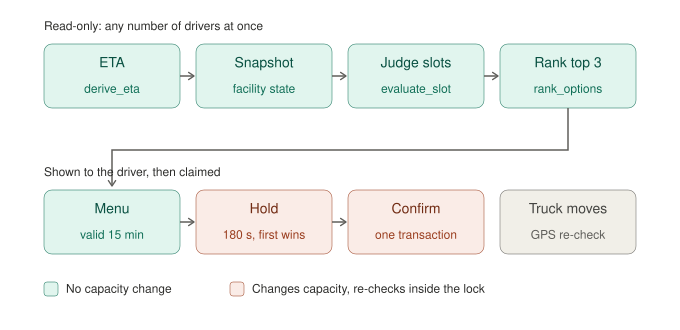
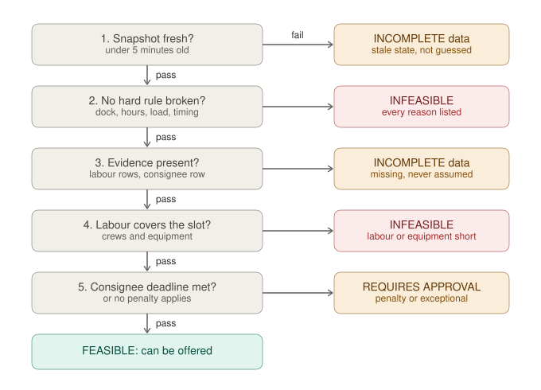
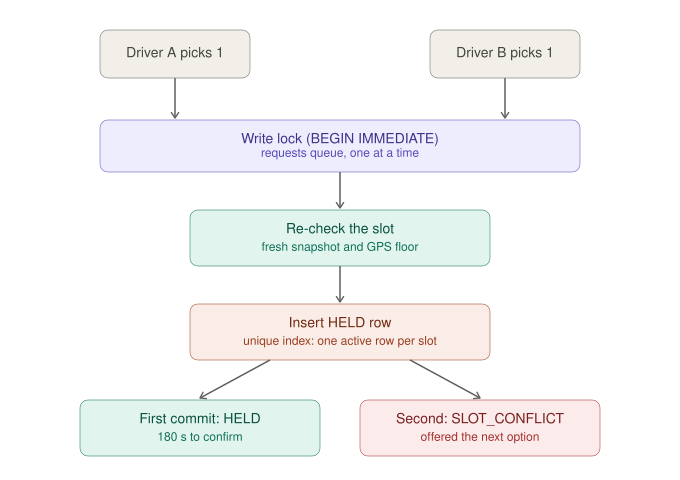

# Scheduling algorithm

> **Changed 2026-11-25 (D93):** the numbered three-option menu is gone. After a delay report the service **holds the first feasible
> slot** and the driver replies **Yes** to book it or **No** for the next one. Steps or examples below that pick a number no longer apply.

How SetuHaul decides which dock slots to offer a late truck, how it stops two drivers taking the same slot, and how it moves a
driver from the old appointment to the new one. This describes the code as it stands; each section names the file and function.
For a guided tour of the same files see [code-walkthrough/03](code-walkthrough/03-eta-feasibility-options.md) and
[04](code-walkthrough/04-holds-confirm-cancel.md). Policy decisions (D5, D6, Q5, Q19) are in [decision-register.md](decision-register.md).

## 1. The idea in one paragraph

The system does not optimise a schedule. It answers one question for one truck: **which slots at its destination can this
truck use, given when it will really arrive?** It works out the arrival time (`eta.py`), judges every slot at the facility against
hard rules and soft evidence (`feasibility.py`), shows the earliest three (`allocation.py`), and only then lets the driver
claim one through a short database-enforced hold (`booking.py`). Nothing is assumed: missing evidence stops the search rather
than being filled in.

## 2. Pipeline

```
 driver message / GPS ping
        │
        ▼
 1. ETA          derive_eta                      → EtaEvidence | ClarificationNeeded | EtaConflict
        │            (+ GPS floor: gps_arrival_floor)
        ▼
 2. Context      build_context                   → FeasibilityContext (truck, load, ETA, constraints, consignee)
 3. Snapshot     build_facility_state            → FacilityState (slots, docks, events, occupancy, labour, rules)
        ▼
 4. Search       search_feasible_slots           → every slot judged: FEASIBLE / INFEASIBLE /
        │            └ evaluate_slot per slot       REQUIRES_APPROVAL / INCOMPLETE_FEASIBILITY_DATA
        ▼
 5. Rank         rank_options (top 3)            → numbered menu, stored by record_option_set (valid 15 min)
        ▼
 6. Hold         acquire_hold                    → HELD appointment, 180 s, FCFS at commit
        ▼
 7. Confirm      confirm_reschedule              → old appointment ended, hold promoted, one transaction
```



Steps 1–5 are read-only and can run concurrently for any number of drivers. Steps 6–7 are the only writes, and each re-checks
the slot inside the write lock.

## 3. Step 1: when will the truck arrive? (`eta.py`)

`derive_eta(report, planned, current, gate, clock, gps_travel_minutes=…)` returns exactly one of three results. First match wins:

| # | Condition | Result |
|---|---|---|
| 1 | Gate check-in recorded, no delay report | `EtaEvidence`, eta = gate time, source `GATE_CHECKIN`, **HIGH** |
| 2 | Gate check-in recorded **and** a delay report | `EtaConflict` `CONTRADICTORY_ARRIVAL_STATE` (a human decides) |
| 3 | No delay report | `ClarificationNeeded` `NO_DELAY_INFORMATION` |
| 4 | Driver states a time | eta = declared time, source `DRIVER_DECLARED` |
| 5 | Repair, travel time known | eta = repair start (or now) + repair + travel |
| 6 | Repair, travel time unknown, GPS fresh | eta = start + repair + GPS travel, source `GPS_ASSISTED`, confidence capped at **MEDIUM** |
| 7 | Repair, travel time unknown, no GPS | `ClarificationNeeded` `MISSING_TRAVEL_TIME` |
| 8 | "N minutes late" | eta = baseline + N. Baseline is the **planned** ETA (D6) unless the driver names the current ETA. A missing baseline gives `MISSING_PLANNED_ETA` / `MISSING_CURRENT_ETA` |

**GPS cross-check** (rows 4 and 8, `_with_gps_check`). With a fresh ping, `gps_eta = now + travel`. If the driver's ETA differs
from it by **more than 30 minutes** (`gps_mismatch_minutes`; exactly 30 is tolerated), the driver's figure is kept but confidence drops one
level (HIGH→MEDIUM→LOW) and `gps_discrepancy_minutes` is recorded. The driver's word is never overwritten here.

**Travel time** (`travel.py`): haversine great-circle distance × road factor 1.3, divided by 40 km/h, rounded **up** to whole
minutes. No routing service. A ping is *fresh* for 15 minutes (`gps_max_age_minutes`); a future-dated ping counts as age zero.

## 4. Step 2–3: the context and the snapshot

**`FeasibilityContext`** (`build_context`) carries what decides eligibility: the load (`expected_unload_min`, `required_dock_type`,
`load_weight_kg`, `temperature_control_required`), `release_time` (the ETA, i.e. earliest the truck can start unloading), the driver's
optional earliest/latest acceptable times, the consignee commitment (or `None` if unknown), `own_slot_id` (the slot the shipment
already has, so it is never offered back), `now`, and an optional `eta_buffer_minutes` (default 0).

**GPS floor** (`gps_arrival_floor`). Before searching, the tool computes `now + drive(latest fresh ping → this dock)`. If that is *later* than the
ETA, the search uses it instead and marks the source `GPS_ASSISTED`. The floor only ever pushes arrival later, never earlier, so GPS cannot
make a driver look faster than they said (`tools.py`, search handler; `option_history.context_now`).

**`FacilityState`** (`build_facility_state`) loads one facility into memory in a handful of queries: rules, docks, slots, dock events,
occupancy and labour windows, stamped with `as_of`. Evaluation is then pure, with no database access per slot.

* **Occupancy** counts statuses `PENDING_CONFIRMATION`, `CONFIRMED`, `IN_PROGRESS` and `HELD`. A `HELD` row whose `expires_epoch <= as_of`
  is excluded, so a lapsed hold frees its slot the instant its time is up, whether or not the sweep job has run.
* **`effective_events`**: a blocking event (`MAINTENANCE`, `BREAKDOWN`, `MANUAL_BLOCK`, `CAPACITY_REDUCTION`) is closed early by the first
  `REOPENED` event at or after its start. A blocking event with no end stays open.
* **`slot_version`**: a 16-hex hash of the slot's status and times, its dock's status/type/weight limit, any overlapping effective events, and
  the occupant. If it differs between "shown" and "hold requested", the option has gone stale. (Labour and facility rules are not in it; rule changes
  are caught separately by `rules_version`, and labour by re-running the full evaluation.)

## 5. Step 4: judging a slot (`feasibility.evaluate_slot`)

Every slot at the facility is judged. The checks run in a fixed order and stop at the first group that produces a verdict:

```
stale snapshot?  ── yes ─▶ INCOMPLETE_FEASIBILITY_DATA (STALE_FACILITY_STATE)    snapshot older than 5 min
      │ no
any hard reason? ── yes ─▶ INFEASIBLE   (ALL failing reasons listed, not just the first)
      │ no
labour / consignee evidence missing? ── yes ─▶ INCOMPLETE_FEASIBILITY_DATA
      │ no
labour or equipment short? ── yes ─▶ INFEASIBLE (LABOUR_UNAVAILABLE | EQUIPMENT_UNAVAILABLE)
      │ no
slot starts after consignee latest_arrival?
      ├─ penalty or exceptional ─▶ REQUIRES_APPROVAL (CONSIGNEE_LATEST_ARRIVAL_BREACH)
      └─ otherwise ─────────────▶ FEASIBLE + warning CONSIGNEE_DEADLINE_MISSED_NO_PENALTY
      │ no
FEASIBLE
```



### 5.1 Hard reasons (`_hard_reasons`)

| Code | Fires when |
|---|---|
| `OWN_CURRENT_SLOT` | the slot is the shipment's current appointment |
| `SLOT_IN_PAST` | `slot.start < now` |
| `SLOT_BLOCKED` | `slot.status != OPEN` |
| `DOCK_UNAVAILABLE` | `dock.status != ACTIVE` |
| `DOCK_EVENT_BLOCK` | an effective event overlaps the slot (`e.start < slot.end and (e.end is None or e.end > slot.start)`) |
| `SLOT_HELD` / `SLOT_OCCUPIED` | another shipment holds / has booked it (reported separately) |
| `OUTSIDE_FACILITY_HOURS` | slot not within open–close on its **local** date (facility timezone) |
| `AFTER_LAST_NEW_START` | rule `LAST_NEW_START_TIME` ("HH:MM") is set and the slot's local start is later |
| `DOCK_TYPE_MISMATCH` | load needs a specific dock type (not `ANY`) and the dock differs |
| `REFRIGERATION_REQUIRED` | temperature-controlled load, dock not refrigerated |
| `HEAVY_DOCK_REQUIRED` | rule `HEAVY_DOCK_REQUIRED_KG` set, load ≥ threshold, dock not `HEAVY` |
| `WEIGHT_EXCEEDS_DOCK_LIMIT` | load > dock `max_weight_kg` |
| `UNLOAD_EXCEEDS_SLOT` | unload minutes > slot length + 0.5 min tolerance |
| `RELEASE_AFTER_SLOT_START` | `release_time + buffer > slot.start`: the truck cannot get there in time |
| `BEFORE_DRIVER_EARLIEST` / `AFTER_DRIVER_LATEST` | outside the driver's stated window |

### 5.2 Labour (`_labour_check`)

Returns `(reason, data_present)`.

1. Windows touching the slot's calendar day. **None** → `data_present = False` → the slot is `INCOMPLETE`. Labour is never assumed to exist.
2. Windows overlapping the slot, sorted by start. A cursor walks from `slot.start`; a gap or short coverage → `LABOUR_UNAVAILABLE`.
3. Any overlapping window with `equipment_available = false` → `EQUIPMENT_UNAVAILABLE`.
4. `needed = (other active appointments overlapping this slot, excluding this shipment) + 1`. The **minimum** crew count across the
   overlapping windows must be ≥ `needed`, else `LABOUR_UNAVAILABLE`. The requester's own booking is excluded because it will move.

This is a facility-wide crew cap, not a per-dock one: two trucks at different docks in overlapping slots both consume crews.

### 5.3 Why the order matters

* Hard infeasibility is reported **before** missing data, so a slot that can never work is not described as "unknown".
* Missing data is reported **before** labour infeasibility, so "no labour rows" is never confused with "labour is short".
* Unknown consignee commitment (no row) makes every otherwise-eligible slot `INCOMPLETE`. A row with no deadline is *known*.

## 6. Step 4b: the search result (`search_feasible_slots`)

Each slot's verdict is bucketed (feasible, approval, incomplete); infeasible slots only add their reasons to `rejection_counts`
(used in hand-off summaries). Each bucket is sorted by `(slot_start, dock_code)`. The overall status is the first that applies:

`OK` (any feasible) → `REQUIRES_APPROVAL` → `INCOMPLETE_FEASIBILITY_DATA` → `NO_SLOT`.

`search_for_shipment` refuses to search at all on an `EtaConflict` (`ETA_CONFLICT`) or `ClarificationNeeded` (`NEEDS_INPUT`).
Any status other than `OK` raises a hand-off to operations and the driver is told nothing is promised.

## 7. Step 5: ranking (`allocation.rank_options`)

Keep `FEASIBLE` only; sort by `(slot_start, dock_code, slot_id)` so ties are identical on every run; take the first **3**, ranked 1–3.
The ranking is purely "earliest first". `wait_minutes` (floor of slot start minus release time) is reported but does not reorder.

`record_option_set` stores the menu exactly as shown: each item's `slot_version` and decision hash, the context, and
`rules_version`. It is valid for **15 minutes** (`OPTION_TTL`, provisional Q19) and kept 30 days for audit.

## 8. Step 6: allocation and holds (`booking.acquire_hold`)

**Policy (D5): first come, first served at successful hold commit.** Priority is advisory and never pre-empts an existing hold. A
CRITICAL shipment can lose a slot to an earlier NORMAL one and falls back to its next option or a human. `allocation.allocate_fcfs` is the pure
statement of the rule (each request in commit order takes its best still-free option); the real arbiter is the database.



`acquire_hold` runs in one `BEGIN IMMEDIATE` transaction (concurrent requests queue on the write lock):

1. Load the menu (proves it belongs to this driver, thread and shipment) and find the chosen rank (`INVALID_OPTION` otherwise).
2. Expire any overdue hold on the same shipment or slot (lazy expiry).
3. Menu past its 15 minutes → `OPTION_EXPIRED`.
4. Shipment already holds a slot: the same slot is **idempotent** (returns the existing hold); a different slot is `SHIPMENT_ALREADY_HELD`
   unless `supersede` is set (switching options).
5. **Re-judge** the chosen slot against a fresh snapshot and the truck's current GPS floor (`diff_option_set`). Only `UNCHANGED` and
   `CHANGED_STILL_FEASIBLE` pass. Taken by someone else (`NEWLY_HELD`, `NEWLY_OCCUPIED`) → `SLOT_CONFLICT`; any other change → `OPTION_CHANGED` with the diff.
6. If superseding, release the old hold in the same transaction (rolled back with everything else if the insert fails).
7. Insert an `appointments` row, status `HELD`, `is_current = 0`, plus `appointment_hold_meta` (owner, menu, expiry 180 s). Because the hold is in the
   same table and the same active-slot **unique index** as real bookings, a race that gets past step 5 is rejected by the database
   (`sqlite3.IntegrityError` → `SLOT_CONFLICT`). The index, not application code, is the lock.

A hold lapses after `hold_ttl_seconds = 180`. It is released by (a) lazy expiry on the next acquire/confirm, (b) the sweep job
`jobs/expire_holds.py` every 30 s, and (c) it never counts in occupancy once past expiry.

## 9. Step 7: confirmation (`booking.confirm_reschedule`)

One `BEGIN IMMEDIATE` transaction; all steps commit together or not at all.

1. **Idempotency**: the key is `(driver, thread, message_id, action)`. Same fingerprint replays the stored answer; a different fingerprint is `IDEMPOTENCY_MISMATCH`.
2. Hold must exist and belong to this driver, thread and shipment (`AuthError` otherwise). Already `CONFIRMED` → `ALREADY_CONFIRMED`. Not `HELD` → `HOLD_EXPIRED` / `HOLD_NOT_ACTIVE`. Past expiry → expire it, `HOLD_EXPIRED`.
3. **Re-evaluate** the held slot with `evaluate_slot` at `now` and the GPS floor. Not `FEASIBLE` → release the hold, keep the original appointment, return
   `FEASIBILITY_CHANGED` (or `APPROVAL_REQUIRED`).
4. Original appointment `IN_PROGRESS` (unloading started) → release the hold, `ORIGINAL_NOT_RESCHEDULABLE`.
5. End the original (`CANCELLED`, reason `RESCHEDULED`), promote the hold to `CONFIRMED` / `is_current = 1` (linked via `replaced_appointment_id`), record
   history events, enqueue downstream notices (outbox, delivered after commit), store the idempotent result.

**The original appointment stays active until this transaction commits.** Any failure rolls everything back, returns `SYSTEM_ERROR` / `LOCK_TIMEOUT`, and promises the driver nothing.
Tests inject faults at six named points (`BEFORE_END_ORIGINAL` … `AFTER_IDEMPOTENCY`) to prove the rollback is complete.

## 10. The truck moves (`position.py`, `booking.reassess_hold_after_position_change`)

Every new GPS ping triggers `handle_new_position` for each of the driver's open loads (earliest planned ETA first; only the first announces).

1. **Release.** A live hold is re-judged with the new position. If the *only* relevant failure is `RELEASE_AFTER_SLOT_START` (truck cannot reach it any more), the hold
   is released at once with reason `POSITION_CHANGED` and the driver is told. The original appointment is untouched.
2. **Acknowledge.** Otherwise the driver is told the distance, drive time and earliest arrival.
3. **Offer earlier slots.** If the shipment relies on a slot (live hold, else current appointment), the search is re-run from the earliest arrival. Candidates must start at least
   `gps_reoffer_gain_minutes` (**30**) before the current slot and not be that slot. The top 3 become a numbered menu. **Nothing is held** until the driver picks one; picking swaps the hold (§8 step 4/6).
   * If the driver earlier gave a later arrival figure that was the binding limit of the last menu (`release_source != GPS_ASSISTED`), it still stands: a closer GPS fix alone does not override it.
   * The same offer is not re-sent: skipped if the latest unexpired menu already starts with the same slot.

## 11. Parameters

| Parameter | Value | Where |
|---|---|---|
| Hold lifetime | 180 s | `config.hold_ttl_seconds` |
| Expiry sweep | every 30 s | `config.expiry_sweep_seconds` |
| Option menu lifetime | 15 min | `option_history.OPTION_TTL` (provisional, Q19) |
| Options shown | 3 | `allocation.DEFAULT_OPTION_COUNT` |
| Max snapshot age | 5 min | `feasibility.DEFAULT_MAX_STATE_AGE` |
| GPS freshness | 15 min | `config.gps_max_age_minutes` |
| GPS vs driver ETA tolerance | 30 min | `config.gps_mismatch_minutes` |
| Speed / road factor | 40 km/h / 1.3 | `config.gps_avg_speed_kmph`, `gps_road_factor` |
| Earlier-slot gain | 30 min | `config.gps_reoffer_gain_minutes` |
| Unload tolerance | 0.5 min | `feasibility._hard_reasons` |
| ETA safety buffer | 0 min | `FeasibilityContext.eta_buffer_minutes` |
| Allocation policy | `FCFS_AT_HOLD_COMMIT` | `allocation.ALLOCATION_POLICY` |

## 12. Design properties and limits

* **Deterministic.** Same snapshot, same context, same menu. Every sort has a total tie-break.
* **No assumed evidence.** Missing labour, consignee data, a stale snapshot, an unknown baseline or missing travel time each stop the flow (clarify, `INCOMPLETE`, or hand-off).
* **Checked twice.** A slot is judged when shown, again at hold, and again at confirm, each time against fresh state and the truck's current position.
* **The database arbitrates.** Capacity is enforced by one unique index over active appointments including holds; the application checks are for good messages, not for correctness.
* **Greedy, not optimal.** Each driver is served independently, earliest slot first. There is no global assignment, no re-shuffling of existing bookings to fit a CRITICAL load, and no
  wait-cost or priority weighting in ranking.
* **Straight-line travel.** Haversine × 1.3 at 40 km/h ignores real roads and traffic. It is used only as a floor on arrival and as a cross-check, never to make arrival earlier.
* **Single-facility search.** Only the shipment's destination facility is searched.
* **Facility-wide labour cap.** Crew demand is counted across all docks at the facility.

## 13. Determinism

**Given the same inputs, the algorithm returns the same result.** The inputs include the clock, so "same" means the same facility
snapshot, the same context (ETA, load, constraints, consignee, `now`) and the same GPS ping.

### Deterministic

* `evaluate_slot` and `search_feasible_slots` are pure functions of the context and the snapshot. They use no randomness and do not depend on dict or set order.
* Every ordering has a total tie-break: search sorts by `(slot_start, dock_code)`, ranking by `(slot_start, dock_code, slot_id)`.
* All failing hard reasons are collected together, so a verdict never depends on which rule happened to fire first.
* `slot_version` and the decision digest are hashes of sorted facts, so they are stable between runs.

### Not deterministic

| Source | Effect |
|---|---|
| The clock (`now`) | Drives slot-in-past, the 5-minute snapshot age, hold expiry, the 15-minute menu life and GPS freshness. The same request a minute later can produce a different menu. |
| Live data | Occupancy, dock events, labour rows and the latest GPS ping change continuously, and the GPS floor moves the arrival time. |
| Commit order | When two drivers want one slot, whoever commits first wins (FCFS, D5). `allocate_fcfs` is deterministic only once that order is fixed; the database arbitrates in production. |
| Identifiers | Appointment ids use `uuid4`, so they differ between runs. They never influence which slot is chosen. |
| The model layer | An LLM turns the driver's message into a delay report and picks an option. Its interpretation can vary. That is outside the scheduling code, which only receives the structured result. |

### Reproducing a result

Freeze the clock (the injectable `Clock`), fix the database and fix the structured report: the menu, the hold and the confirmation then repeat exactly,
apart from the generated ids. `scripts/replay_traces.py` is the repo's tool for replaying recorded traces.
